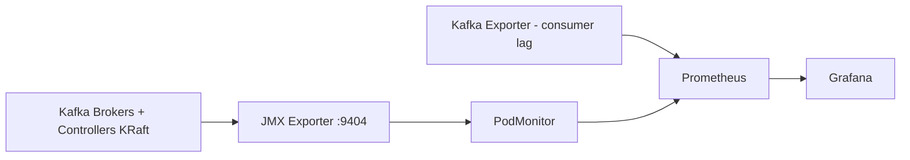
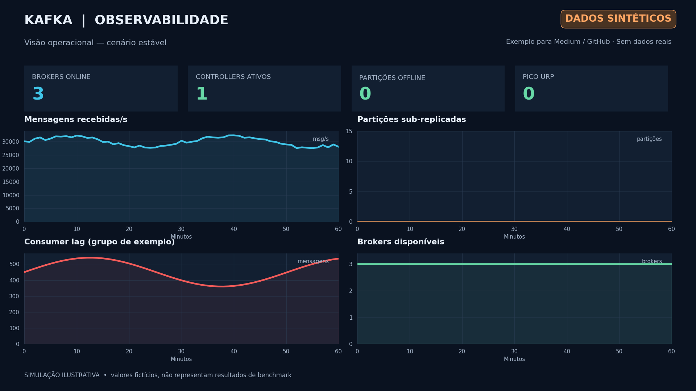
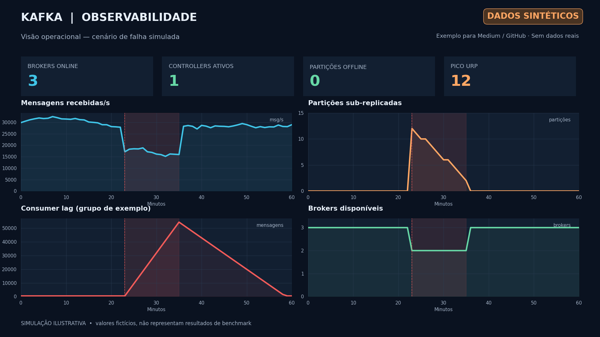

# Kafka Enterprise na Prática — Artigo 5 de 7

**Observabilidade Kafka com Red Hat OpenShift, Prometheus e Grafana**

Repositório complementar ao quinto artigo da série técnica **Kafka Enterprise na Prática**. O objetivo é ilustrar a observabilidade de um cluster Red Hat Streams for Apache Kafka 3.2 com brokers e controllers KRaft distribuídos entre zonas de disponibilidade.

Este material é **didático**: os nomes são fictícios, não há dados confidenciais, e as imagens são **simulações com métricas sintéticas**, não capturas de uma instalação real. Os YAMLs são exemplos e precisam ser ajustados antes de uso corporativo. Não se trata de um produto ou configuração oficial da Red Hat.

## O que está incluído

| Diretório / arquivo | Conteúdo |
|---|---|
| `manifests/01-kafka-metrics-configmap.yaml` | Regras JMX Exporter para brokers e controllers KRaft |
| `manifests/02-podmonitor.yaml` | Descoberta dos pods Kafka e Kafka Exporter pelo Prometheus |
| `manifests/03-example-alerts-optional.yaml` | Alertas de exemplo; **não aplicados por padrão** |
| `scripts/01-enable-kafka-metrics.sh` | Patch controlado para habilitar `metricsConfig` em um Kafka **existente** |
| `scripts/02-enable-kafka-exporter.sh` | Patch opcional para consumer lag, com confirmação explícita |
| `scripts/03-validate.sh` | Checagens read-only no OpenShift e dicas de validação |
| `grafana/kafka-operational-health.json` | Dashboard Grafana importável (saúde, KRaft, throughput, consumer lag) |
| `grafana/queries.md` | Todas as consultas PromQL do dashboard |
| `docs/arquitetura.mmd` | Diagrama Mermaid editável |
| `docs/validacao.md` | Procedimento detalhado e troubleshooting |
| `docs/observacoes-producao.md` | Limitações, segurança e cuidados operacionais |
| `examples/` | Figuras ilustrativas de operação saudável e falha **simuladas** |
| `.github/workflows/validate.yml` | CI para validar estrutura dos YAMLs, JSON e scripts |

## Arquitetura lógica



O **JMX Exporter** disponibiliza métricas do processo Kafka. O **Kafka Exporter** agrega informações de tópicos, consumer groups e offsets, úteis para o cálculo de lag. O `PodMonitor` informa ao Prometheus onde coletar essas séries. Em instalações OpenShift, o User Workload Monitoring precisa estar habilitado e autorizado a selecionar os monitores.

## Pré-requisitos

- Red Hat OpenShift com `oc` autenticado e permissões de edição no projeto.
- Red Hat Streams for Apache Kafka Operator 3.2 e recurso `Kafka` **já instalado**. Este repositório não instala Kafka nem o Operator.
- Monitoring para projetos de usuário (User Workload Monitoring) e CRD `monitoring.coreos.com/v1` (`PodMonitor`).
- Um datasource Prometheus acessível pelo Grafana. O Grafana **não** é implantado aqui.
- Para o exemplo, reusamos `Kafka/streaming-demo` e o namespace `streaming-demo` do [Artigo 2](https://github.com/gabrielgarbes/kafka-enterprise-artigo-02).
- Caso os nomes no seu ambiente sejam diferentes, altere-os nos manifestos, variáveis de shell e consultas PromQL. **Não publique nomes reais ou informações sensíveis** em repositórios públicos.

## Implementação (exemplo demonstrativo)

### 1) Verifique o que já está instalado

```bash
oc get kafka,kafkanodepool -n streaming-demo
oc get podmonitor -n streaming-demo
```

> **Se você aplicou o exemplo do Artigo 2:** já existe um ConfigMap `kafka-metrics` e um PodMonitor `kafka-resources-metrics`. Confira o diff antes de atualizar. A atualização das regras de métricas pode exigir reconciliação dos pods.

### 2) Publique o ConfigMap e o PodMonitor

```bash
oc apply -k .
```

Se ainda não houver suporte a `PodMonitor` no cluster, habilite primeiro o monitoramento conforme a política de administração do OpenShift.

### 3) Habilite o JMX Exporter no Kafka existente

Este passo preserva as demais seções da configuração `Kafka`:

```bash
export KAFKA_NAMESPACE=streaming-demo
export KAFKA_CLUSTER=streaming-demo
bash scripts/01-enable-kafka-metrics.sh
```

> O patch de `spec.kafka.metricsConfig` pode disparar reconciliação de componentes. Execute em janela de mudança apropriada e valide `Ready=True` depois.

### 4) Opcional — habilite o Kafka Exporter

No exemplo do Artigo 2, o `Kafka Exporter` já foi configurado. Se o seu Kafka não tiver `spec.kafkaExporter`, revise primeiro sua política de autorização, e somente então:

```bash
export CONFIRM_ENABLE_EXPORTER=yes
bash scripts/02-enable-kafka-exporter.sh
```

O comando contém um aviso proposital e só aplica a mudança após a variável de confirmação. Faça diff do recurso antes de executá-lo; **não** use o script para substituir uma configuração já personalizada sem revisão.

### 5) Confira os alvos e importe o dashboard

```bash
bash scripts/03-validate.sh
```

No Grafana, vá a **Dashboards → New → Import** e selecione `grafana/kafka-operational-health.json`. Informe o datasource Prometheus e selecione o namespace. Para métricas não disponíveis, o Grafana mostrará `No data` — esse resultado **não** equivale a zero.

## Visuais sintéticos para o artigo

**1. Operação saudável (dados sintéticos):**



**2. Indisponibilidade simulada de broker (dados sintéticos):**



Essas imagens são ilustrativas e **não** devem ser apresentadas como screenshots ou resultados reais de testes de performance. Foram criadas para demonstrar como as métricas podem auxiliar a análise de comportamento e recuperação.

## Métricas centrais

- Brokers com métricas e controller ativo: saúde básica dos componentes.
- `UnderReplicatedPartitions` e `OfflinePartitionsCount`: acompanhamento de replicação e disponibilidade.
- `MessagesInPerSec`, `BytesInPerSec` e `BytesOutPerSec`: taxas de ingestão e tráfego.
- KRaft `current-leader`, `current-epoch`, `number-of-voters`: estabilidade do quórum.
- Consumer lag: diferença entre o último offset e o offset confirmado do consumer group.
- CPU e utilização dos PVCs: painéis opcionais, dependentes da exposição de métricas pelo OpenShift.

Leia [consultas PromQL](grafana/queries.md) e [validação/troubleshooting](docs/validacao.md). **Não assuma nomes de métricas universais:** as séries dependem da versão do Kafka, da configuração dos MBeans e das regras JMX Exporter.

## Segurança e limitações

- Nenhuma credencial, token ou certificado real está neste repositório.
- As regras de JMX incluídas são **selecionadas e reduzidas**, não cobertura integral dos MBeans.
- Não incluímos instalação de Prometheus/Grafana nem permissões amplas de cluster.
- O PodMonitor seleciona pods no namespace fictício `streaming-demo`; em instalações corporativas o Prometheus pode exigir labels/seletores adicionais.
- O endpoint de métricas deve permanecer restrito aos componentes autorizados.
- Todas as mudanças declarativas precisam ser validadas no ambiente de destino; `oc apply` não é um teste de carga nem uma validação de suporte de produção.

Leia também [Notas para produção](docs/observacoes-producao.md).

## Referências

Consulte [Referências oficiais](docs/referencias.md), incluindo a documentação do **Red Hat Streams for Apache Kafka 3.2**, Prometheus e Grafana.

## Licença

Código e documentação do repositório sob [MIT License](LICENSE). Não é conteúdo oficial da Red Hat nem material suportado comercialmente.
